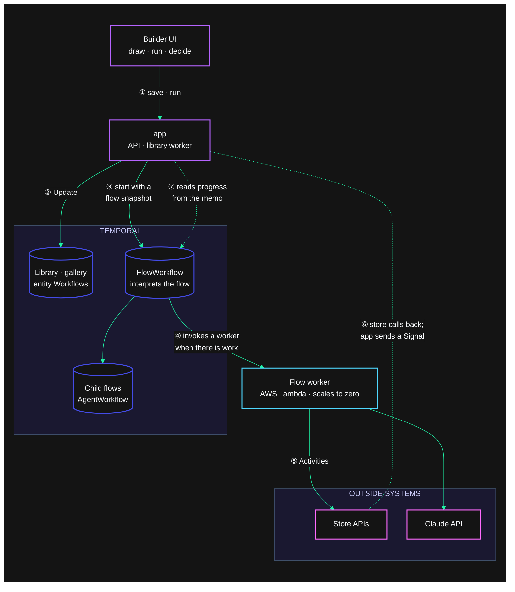

# Visual Workflows

A visual workflow builder where every flow you draw runs as a durable Temporal Workflow, on workers that scale to zero.

- **Steps that call out** are [Activities](https://docs.temporal.io/activities). Each step has its own [retry policy](https://docs.temporal.io/encyclopedia/retry-policies) and timeouts, which it can inherit from the flow. Steps can also carry an undo request, so a failed run compensates in reverse order (a [saga](https://docs.temporal.io/design-patterns/saga-pattern.md)). HTTP and Claude calls [heartbeat](https://docs.temporal.io/encyclopedia/detecting-activity-failures#activity-heartbeat) while they wait. If a worker dies mid-call, Temporal retries within seconds instead of waiting out the step's timeout. A step cancelled mid-call, for example one that lost a race, has its request aborted.
- **When retries run out:**
  - A step can switch to slow retries (fast/slow retries).
  - It can pause until a person corrects its request and retries it (a resumable Activity).
  - A `Retry-After` header sets the next retry's delay.
- **Events from outside** arrive as [Signals](https://docs.temporal.io/sending-messages#sending-signals). Every run has a callback URL, and a POST to it is the same as sending the Signal from the Temporal UI.
- **Event lanes:** an *On signal* lane runs once per event. An *On update* lane runs for a validated [Update](https://docs.temporal.io/sending-messages#sending-updates) and returns its *Respond* step's value to the caller. Lanes change the run's variables while the main path is mid-flight. Visible variables are readable through a Query.
  - An *On start* lane is the run's init: it runs once, before the main path and before any lane handles a message.
  - Keyed flows take messages with start: [Signal-With-Start](https://docs.temporal.io/sending-messages#signal-with-start) and [Update-With-Start](https://docs.temporal.io/sending-messages#update-with-start) reach the key's run, starting it first if needed, from a hook URL or the Run dialog. The On start lane runs before the message is handled.
- **Waiting is free:**
  - *Wait for signal*, *Wait for condition*, approvals, and timers all hold the run with no compute.
  - Timers can be a fixed amount, or an expression that recalculates when a lane changes a variable.
  - *Wait for signal* can collect a batch: it gathers events until they go quiet and drops duplicates.
- **Loops:** a *Loop* step repeats its body until a condition holds, with a durable pause between passes. Use it for polling, or for paging through a dataset with a cursor.
- **Fan out, fan in, pick first:**
  - Draw several edges out of a step and the branches run in parallel. A step with several edges in waits for all of them (a join).
  - *First of* races the branches and cancels the losers. Set it to *first branch to succeed* for a hedged request: failed branches drop out, and the step takes its error outcome only when every branch has failed.
  - *For each* fans out over a list as child Workflows, and finishes when every child succeeds, when the first does, or when a quorum does. Then it cancels the rest.
- **Composition:** *Run flow* and *For each* run other saved flows as [child Workflows](https://docs.temporal.io/child-workflows). *For each* takes up to 10,000 items, and larger sets page through a *Loop*.
  - *Run flow* sets the [Parent Close Policy](https://docs.temporal.io/parent-close-policy). It can also fire and forget: it doesn't wait for the child, which is abandoned so it outlives the parent.
- **Lifetime and keys:** a run completes when its main path does, like any Workflow. To hold it open for events for a while, end the main path with a *Delay* or a wait.
  - Turn on **Entity workflow** ([entity pattern](https://docs.temporal.io/design-patterns/entity-workflow.md)) and the run lives as long as the thing it models: after its main path, lanes keep handling its events until an *End run* step, or for ever if the flow has none.
  - **Keyed by** is separate: it gives the flow one run per key, so senders address it by key: the key is part of its Workflow ID. Unkeyed runs are addressed by the Workflow ID they get at start. Once a key's run completes, its next event starts afresh. Entities can be keyed or not.
  - Keyed flows set their [Workflow ID conflict and reuse policies](https://docs.temporal.io/workflow-execution/workflowid-runid#workflow-id-conflict-policy): whether a start for a running key uses that run, fails, or terminates it, and whether a closed key can run again.
- **Continue-As-New for every flow:** any run, keyed or not, [continues as new](https://docs.temporal.io/workflow-execution/continue-as-new) when Temporal suggests it, and only then.
  - It stops at a safe point: waits are interrupted and resume in the next run with their original deadlines, while Activities and child Workflows already running finish first.
  - It carries its progress over, so long loops, big batches, and busy entities run as long as they need to.
- **Triggers:** a manual start, a webhook, or a [Schedule](https://docs.temporal.io/schedule) (an interval, cron with a time zone, or weekdays and a time).
  - Starts can be delayed.
  - A *Respond* step on the main path answers the caller right away through [Update-With-Start](https://docs.temporal.io/sending-messages#update-with-start), while the run carries on (early return).
  - Runs carry a priority, and a fairness key per user, so one user's burst can't starve everyone else.
- **AI agent:** a Claude ReAct loop as a child Workflow. Every model turn and tool call is a durable step, and the agent can stop to ask a person.
- **Platform:**
  - An overview, workflows, executions, schedules, and a template gallery.
  - A design pattern library: all 35 patterns in Temporal's [catalog](https://docs.temporal.io/design-patterns). Each shows how to build it in the designer, what to use it for, and what to watch for, and most open as a runnable example.
  - Templates can be shared with everyone or by private link.
  - Version history, and flows laid out left-to-right or top-down.
  - Saved flows live in Temporal itself (an entity Workflow per user), with no database.

## How it works



1. You build a flow in the UI and save it.
2. The app stores it with an Update to your library Workflow; flows, versions, and shared templates all live in Temporal.
3. Running a flow starts `FlowWorkflow` with a snapshot of the flow as its input, so later edits never touch it. Agent steps and Run flow / For each steps start child Workflows.
4. Temporal invokes a worker on AWS Lambda only when a run has work; while runs wait on events, timers, or people, nothing is running.
5. Steps that call out run as Activities with their own retry policies.
6. Outside systems resume runs by calling a run's callback URL; the app turns each call into a Signal.
7. The run view reads progress from the Workflow's memo, which needs no worker, so watching a run never wakes one.

`FlowWorkflow` (`internal/workflows`) is a small interpreter:

- **One snapshot per run.** Each run receives a snapshot of its flow, so editing a flow never touches runs in flight. Every `case` in `nodes.go` is the Temporal primitive behind one step type.
- **Main path and lanes.** A flow has one main path from its trigger, and lanes from *On signal* and *On update* entries.
  - A step runs once all its incoming edges are decided, so branches and joins need no extra step types. *First of* is the exception: it fires on the first branch to arrive.
  - A *Loop* is the one cycle allowed. Once its body has finished a pass, the loop checks its condition and either resets the body or moves on. The edges back into the loop are drawn but never followed.
  - Lanes share the run's variables, events, and step outputs.
  - Everything runs on one deterministic event loop, so lanes never interleave mid-step.
- **Expressions are deterministic.** Templates like `{{ steps.create_order.body.id }}`, `{{ vars.address }}`, and `{{ events.order_status.status }}` are evaluated in the Workflow, with the clock disabled, so replays always agree.
- **The run view never wakes a worker.** The Workflow keeps a compact progress record in its memo. The API reads that record, the flow snapshot from the run's first history event, and retry attempts from `DescribeWorkflowExecution`. None of these need a running worker, so watching a run costs nothing on serverless. Step outputs are fetched on demand with a Query.
- **Worker Versioning, no patching.** Flow runs are **Pinned** to the worker build they started on. A run moves to the newest build when it continues as new (an entity, a long loop, a big batch), carrying its state.

## The example flows

New users start with these flows. The same flows appear as built-in templates.

| Flow | What to show |
|---|---|
| **Order shipped notification** | Event-driven waiting. The store gets the run's callback URL and reports each status change as an `order_status` Signal. The run sleeps until one says `shipped`. |
| **Resilient payment capture** | A retry policy. The gateway fails three times; the step shows *Attempt 4 of 6*. The bank's settlement callback then arrives as a Signal. |
| **Refund approval** | A person decides, through an Update with a validator. A timeout escalates; it never counts as a rejection. Triggered by a webhook. |
| **Editable order** (top-down) | Lanes change the address or cancel the order. `extend_hold` is an Update that answers with the new hold length. The hold timer recalculates, and a *First of* race either ships or cancels. |
| **Fastest carrier quote** | Fan out and pick the first success. Three carriers are asked at once. Budget Freight is down, so its branch fails and drops out. Swift answers in 4 seconds and wins. The Parcel Post request is cancelled through its heartbeat, and the sandbox logs it as abandoned. |
| **Trip booking (saga)** | The card declines, so the hotel and flight undo requests run in reverse order. |
| **Daily stock report** | A calendar Schedule: weekdays at 9:00 New York time, with pause and run-now. |
| **Customer loyalty (entity)** | One run per customer for the life of their account. Purchases arrive with Signal-With-Start. Points and tier live in variables, however long the customer is quiet. The run continues as new when Temporal suggests it, and `close_account` ends it. |
| **Ship to many customers** | *For each* runs *Order shipped* as child Workflows, two at a time. |
| **AI support triage** | A Claude agent uses HTTP tools, asks a person before a large refund, and returns JSON that later steps branch on. |

Moments worth showing:

- **Change a run while it waits.** Open *Editable order*, send `change_address`, then extend the hold with an Update. The Update's response comes back in the run view, and the timer moves.
- **Crash a worker.** Start *Resilient payment capture* and run `make crash-worker`. The run view keeps showing its progress while no worker is running. Run `make worker` and the run carries on from the same step. (Locally only. In the catalog, show the scale-to-zero version below.)
- **Scale to zero.** In the catalog the worker scales to zero when the task queue is idle. Start a run that waits on a Signal, watch the worker pill go to *none running*, then send the Signal: KEDA starts a worker, and the run carries on.

## Run it

You need Go 1.27, Node 24, and the [Temporal CLI](https://docs.temporal.io/cli). To use the agent step, export `ANTHROPIC_API_KEY`.

```sh
cd web && npm install && cd ..
make dev
```

| URL | What |
|---|---|
| http://localhost:5173 | Builder (Vite dev server) |
| http://localhost:8080 | Builder embedded in the app binary (after `make web`) |
| http://localhost:8233 | Temporal UI |

| Command | Does |
|---|---|
| `make dev` | Starts the Temporal dev server, sandbox, flow worker, app, and UI. Ctrl-C stops them all. |
| `make crash-worker` | `kill -9` the flow worker |
| `make worker` | Starts a flow worker in the foreground |
| `make test` | Go tests (the Workflow test suite) and `svelte-check` |
| `make docker` | The same stack in containers |

To present the demo, follow [RUNBOOK.md](RUNBOOK.md): the walkthrough beat by beat, and where in the code each part happens.

### Configuration

Every process reads Temporal settings from the standard environment variables (`TEMPORAL_ADDRESS`, `TEMPORAL_NAMESPACE`, `TEMPORAL_API_KEY`, `TEMPORAL_TLS_*`) and ignores the CLI config file.

| Variable | Used by | Default |
|---|---|---|
| `TASK_QUEUE` | app, workers | `visual-workflows`; the library uses `<TASK_QUEUE>-library` |
| `TEMPORAL_WORKER_DEPLOYMENT_NAME` (or `TEMPORAL_DEPLOYMENT_NAME`, which the Worker Controller sets), `TEMPORAL_WORKER_BUILD_ID` | workers | `visual-workflows`, `local` |
| `WORKER_SET_CURRENT_VERSION` | worker | unset; `make dev` sets it to `true` so the local build becomes current |
| `WORKER_MODE` | app | `long-lived`; `serverless` changes the worker indicator |
| `ANTHROPIC_API_KEY`, `ANTHROPIC_MODEL` | workers | unset (agent steps fail clearly); `claude-opus-5-5` |
| `SANDBOX_URL` | app | `http://localhost:8090`, written into the example flows |
| `CALLBACK_BASE_URL` | app | the request's host; set it when callers reach the app on an internal address |
| `TEMPORAL_UI_URL` | app | `http://localhost:8233` |
| `SESSION_SECRET` | app | `make dev` sets a fixed local value; set your own when running more than one replica |
| `TRUST_AUTH_HEADERS` | app | `false`; set it to `true` only behind the catalog's SSO ingress |

## Notes

- **Users and sharing.** Each browser is a user, through a signed cookie, or the catalog's signed-in identity when `TRUST_AUTH_HEADERS` is set.
  - Every Workflow ID starts with `vflow-<task queue>-<user>-`, and the API refuses IDs outside the caller's prefix.
  - Signed-in users keep their flows. Anonymous sessions end after 30 idle days.
  - Templates are copies. Publishing lists a template for everyone; a share link reaches it privately; only the author can unpublish.
- **Waiting on events, not polling.** Outside systems resume a run with a POST to its callback URL. Nothing polls.
- **Lane semantics.**
  - A failed step in a signal lane marks that step failed, and the run continues.
  - A failed Update lane returns the error to the caller.
  - A run finishes when its main path does, after any lanes already running have finished.
- **Scale to zero.**
  - In the catalog, `cmd/worker` runs as a versioned Kubernetes worker that KEDA scales between 0 and 5 replicas on task-queue backlog. A run waiting on events, timers, or people uses no worker compute.
  - The first task after an idle period waits for a pod to start. Updates sent to an idle run wait the same way.
  - The app (UI, API, and library worker) stays always on.
  - `cmd/lambda-worker` runs the same Workflows on AWS Lambda through `lambdaworker`. It is not used in the catalog, because Lambda can't reach the in-cluster sandbox.
- **Catalog.** `deploy/demoproject.yaml` is a draft `DemoProject`. It passes the registry's `validate_projects.py` and has not been submitted.
  - The worker, app, and sandbox all run in the cluster, so activities reach the sandbox at `http://sandbox:8090`.
  - Callback URLs shown in the UI use `CALLBACK_BASE_URL`, which is the in-cluster address. The sandbox can use them; callers outside the cluster can't.
